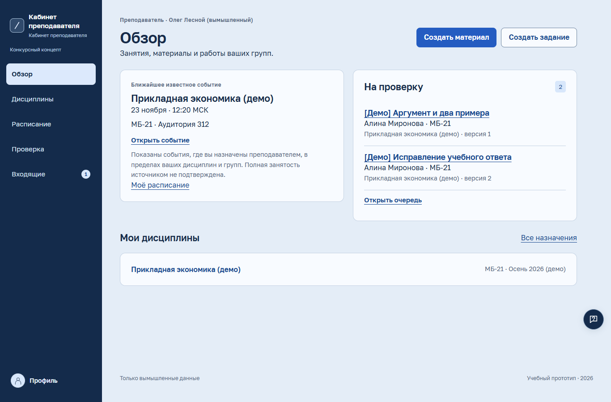

# Цифровой деканат

Найти нужное действие, подготовить вопрос, записаться на консультацию и вернуться к ответу — в одном кабинете вместе с расписанием и результатами учёбы.

**Конкурсный прототип на вымышленных данных. Не официальный сервис вуза.**


## Видео: работа трёх ролей за 4 минуты 22 секунды

[](https://github.com/AiratBastanov/MGIMOSlop/releases/download/v2026.11.15-demo/digital-deanery.mp4)

[Скачать MP4](https://github.com/AiratBastanov/MGIMOSlop/releases/download/v2026.11.15-demo/digital-deanery.mp4) · [Описание и файлы ролика](docs/video/VIDEO.md) · [Русские подписи](docs/video/demo.ru.srt) · [Текст демонстрации](docs/video/transcript.ru.md)

Профиль, поиск расписания, оценки, сохранённая заявка с ответом службы и отзыв к отправленной работе. В конце — мобильное окно 360 px и возврат из режима для слабовидящих. Запись 1920×1080 с русскими подписями, без звуковой дорожки.

## Что можно сделать

Студенческое ядро: вход и профиль, расписание на день и неделю, оценки и зачёты, заявки со статусом, уведомления. На телефоне доступны пять основных разделов. Отсутствие оценки и неподтверждённое расписание показаны явно.

- **Найти нужное.** Поиск в шапке принимает название, номер заявки или обычное слово: «расписание», «профиль», «справка», «обмен», «консультация». Он показывает разрешённые разделы, действия и доступные записи с прямыми ссылками.
- **Решить вопрос.** В заявках можно начать или продолжить подготовку к учебному обмену либо проверку неточности в учебных сведениях. Шаги, вопросы и личные заметки сохраняются. Перед отправкой плана службе студент видит точный состав передаваемых сведений.
- **Получить консультацию.** Преподаватель и служба открывают время для своей аудитории. Студент видит известные пересечения, подтверждает запись и находит её на «Сегодня», в расписании и в «Моих записях». Доступны отмена и перенос с сохранением истории.

| Роль | Связанный рабочий путь |
| --- | --- |
| Студент | Найти действие, сохранить подготовку, отправить план или заявку, ответить на уточнение и выбрать консультацию; работать с учёбой и материалами преподавателя. |
| Преподаватель | Опубликовать материал или задание для своей группы, проверить отправленную версию, сохранить отзыв и открыть время учебной консультации. |
| Факультетская служба | Рассмотреть заявку или отправленный план своего факультета, уточнить вопрос, сохранить решение и провести приём; публиковать объявления и ресурсы групп. |

Решение, уведомление и история согласованы в PostgreSQL. Перезапуск не отменяет действий. Официальные учебные итоги поступают отдельно через проверяемый импорт; результат работы преподавателя не заменяет оценку по дисциплине.

Подготовка к обмену проходит на вымышленной программе «Горизонт». Список возможных документов не устанавливает реальные требования. Отметка студента, рассмотренный план, подтверждённая запись и проведение встречи — разные факты; ни один из них не означает зачисление на обмен.

| Рабочее место преподавателя | Рабочее место службы |
| --- | --- |
| [](docs/images/teacher-workspace.png) | [](docs/images/faculty-workspace.png) |

## Запустить локально

Основной локальный путь — Windows, Python 3.14.10 и установленный PostgreSQL 17.11. Нужен доступ администратора **локального** PostgreSQL для создания отдельной пустой БД. Исходники содержат собранные JS, CSS и шрифты; Node нужен только для пересборки. Поиск, подготовка, консультации и остальные функции работают без Qwen, Ollama и GPU. Область выполненных проверок описана [отдельно](docs/VALIDATION.md).

Из корня скачанного репозитория в PowerShell, выполняя команды по очереди:

```powershell
py -3.14 -m venv .venv
.\.venv\Scripts\python.exe -m pip install -r requirements/runtime.txt
.\.venv\Scripts\python.exe scripts/create_local_database.py --database deanery_demo --port 5548
.\.venv\Scripts\python.exe manage.py migrate --noinput
.\.venv\Scripts\python.exe manage.py prepare_demo --database deanery_demo
.\.venv\Scripts\python.exe manage.py runserver 127.0.0.1:8000 --noreload --insecure
```

Если PostgreSQL установлен на стандартном порту 5432, укажите `--port 5432`. При ошибке остановитесь и откройте [инструкцию установки](docs/SETUP.md). Локальный адрес приложения — **http://127.0.0.1:8000/**.

Логины: `student_a`, `student_b`, `teacher_demo`, `staff_demo`. Новые пароли каждой установки создаются в защищённом файле, который не входит в Git:

```powershell
notepad .\.local\demo-credentials.json
```

## Документация

- [Размещение на Render Free и Neon Free](deploy/RENDER.md)
- [Установка и перезапуск](docs/SETUP.md)
- [Демонстрация трёх ролей](docs/DEMO.md)
- [Архитектура и границы доступа](docs/ARCHITECTURE.md)
- [Исследование и принятые решения](docs/RESEARCH_DECISIONS.md)
- [Необязательный локальный ИИ](docs/AI_ASSISTANT.md)
- [Процесс создания](docs/DEVELOPMENT_PROCESS.md), [PDF](docs/creation-process.pdf), [редактируемый оригинал](docs/creation-process.html)
- [Проверки и их границы](docs/VALIDATION.md)
- [Сторонние компоненты](docs/THIRD_PARTY_NOTICES.md) и [права на материалы](docs/RIGHTS.md)

## Текущие ограничения

Демонстрационные учебные даты относятся к ноябрю–декабрю 2026 года и не передвигаются при запуске. Даты новых консультаций выбираются при явной подготовке примеров и затем сохраняются. Для позднейшего показа принимающая сторона может открыть новое время. Консультации разовые, на одного студента; повторяющегося календаря и очереди ожидания нет.

Прототип не проверяет реальные документы для обмена и не связан с системами вуза.
