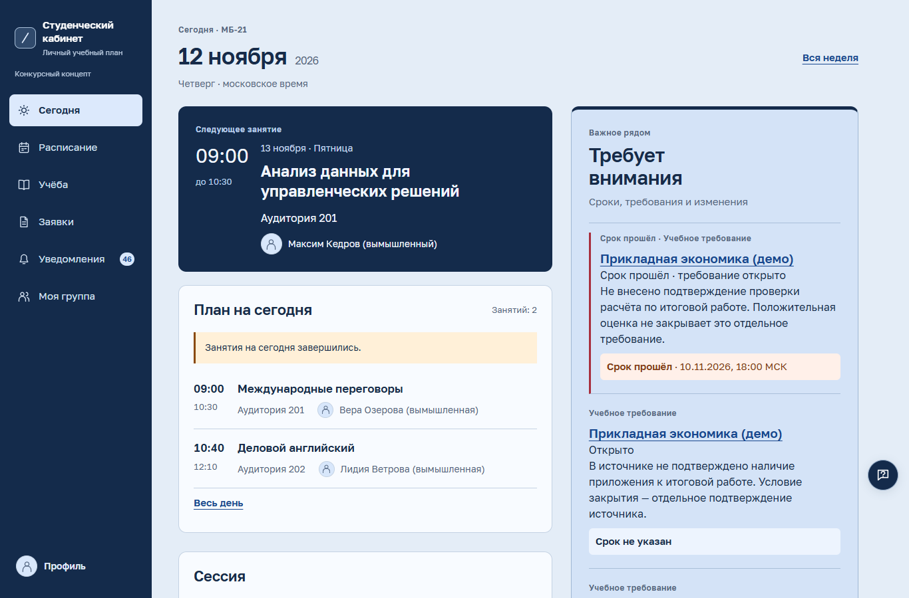
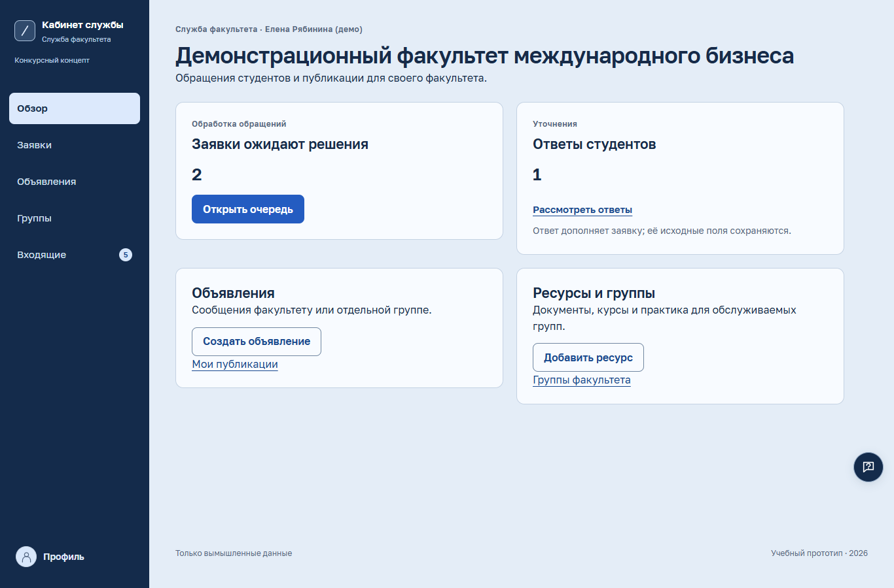

# Цифровой деканат

Учебный день, результаты и обращения в деканат — в одном кабинете. Студент видит ближайшие занятия, замечает перенос, отправляет работу преподавателю или заявку в службу и возвращается к сохранённому ответу.

**Конкурсный прототип на вымышленных данных. Не официальный сервис вуза.**



## Что можно сделать

Студенческое ядро: вход и профиль, расписание на день и неделю, оценки и зачёты, заявки со статусом, уведомления. На телефоне доступны пять основных разделов. Отсутствие оценки и неподтверждённое расписание показаны явно.

| Роль | Связанный рабочий путь |
| --- | --- |
| Студент | Посмотреть учёбу, открыть материал преподавателя, отправить свою версию с приватными файлами, получить отзыв; подать заявку и ответить на уточнение. |
| Преподаватель | Опубликовать материал или задание для своей группы, проверить точную отправленную версию, запросить исправление и сохранить результат работы. |
| Факультетская служба | Обработать заявку своего факультета, уточнить вопрос у студента, записать решение; опубликовать объявление и ресурс группы. |

Решение, уведомление и история согласованы в PostgreSQL. Перезапуск не отменяет действий. Официальные учебные итоги поступают отдельно через проверяемый импорт; результат работы преподавателя не заменяет оценку по дисциплине.

| Рабочее место преподавателя | Рабочее место службы |
| --- | --- |
| [](docs/images/teacher-workspace.png) | [](docs/images/faculty-workspace.png) |

## Запустить локально

Проверенный путь — Windows, Python 3.14.10 и установленный PostgreSQL 17.11. Нужен доступ администратора **локального** PostgreSQL для создания отдельной пустой БД. Исходники содержат собранные JS, CSS и шрифты; Node нужен только для пересборки. Qwen, Ollama и GPU для работы кабинета не нужны.

Из корня скачанного репозитория в PowerShell, выполняя команды по очереди:

```powershell
py -3.14 -m venv .venv
.\.venv\Scripts\python.exe -m pip install -r requirements/runtime.txt
.\.venv\Scripts\python.exe scripts/create_local_database.py --database deanery_demo --port 5548
.\.venv\Scripts\python.exe manage.py migrate --noinput
.\.venv\Scripts\python.exe manage.py prepare_demo --database deanery_demo
.\.venv\Scripts\python.exe manage.py runserver 127.0.0.1:8000 --noreload --insecure
```

Если PostgreSQL установлен на стандартном порту 5432, укажите `--port 5432`. При ошибке остановитесь и откройте [инструкцию установки](docs/SETUP.md). Локальный адрес приложения — **http://127.0.0.1:8000/**.

Логины: `student_a`, `student_b`, `teacher_demo`, `staff_demo`. Новые пароли каждой установки создаются в защищённом файле, который не входит в Git:

```powershell
notepad .\.local\demo-credentials.json
```

## Документация

- [Установка и перезапуск](docs/SETUP.md)
- [Демонстрация трёх ролей](docs/DEMO.md)
- [Архитектура и границы доступа](docs/ARCHITECTURE.md)
- [Необязательный локальный ИИ](docs/AI_ASSISTANT.md)
- [Процесс создания](docs/DEVELOPMENT_PROCESS.md), [PDF](docs/creation-process.pdf), [редактируемый оригинал](docs/creation-process.html)
- [Проверки и их границы](docs/VALIDATION.md)
- [Сторонние компоненты](docs/THIRD_PARTY_NOTICES.md) и [права на материалы](docs/RIGHTS.md)

## Текущие ограничения

Демонстрационные учебные даты относятся к ноябрю–декабрю 2026 года и не передвигаются при запуске. Прототип не выпускает юридически действительные справки. Внешняя доставка писем, публичный хостинг, доступ к приложению из российской сети и конкурсная подача не подтверждены. Мобильные сценарии проверялись в браузерных окнах, физические устройства и полный аудит доступности отдельно не проверялись.

GitHub-репозиторий сохраняет приватную видимость: доступ организаторов к исходникам должен быть предоставлен владельцем отдельно. Публикация исходников не является размещением приложения в интернете.
