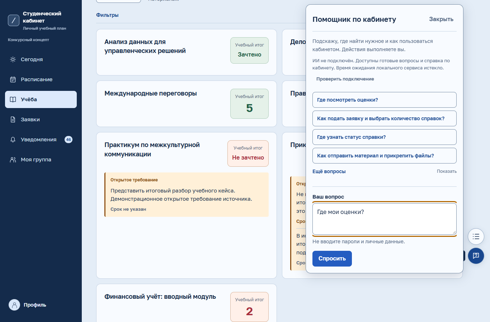

# Необязательный локальный ИИ

[Описание продукта](../README.md) · [Установка](SETUP.md) · [Проверки](VALIDATION.md)

Без Ollama, Qwen и GPU кабинет полностью работает: вход, расписание, результаты, заявки, материалы, отзывы и уведомления. В помощнике доступны готовые вопросы и справочные ссылки. ИИ используется только для выбора темы по свободной формулировке.



## Что именно подключается

Проверенный ранее локальный вариант — **Ollama 0.33.2** и точный идентификатор **`qwen3:4b-instruct-2507-q4_K_M`**. Историческая успешная обработка вопросов этой моделью сохранена в разработческом архиве. При подготовке текущей публикации новый успешный запуск модели не заявляется: основной сценарий проверяется без неё. Ошибки провайдера проверены управляемыми HTTP-примерами.

Django обращается только к явно подтверждённому локальному HTTP endpoint с числовым loopback-адресом. Проверка списка моделей выполняется через [`GET /api/tags`](https://docs.ollama.com/api/tags) с точным сравнением имени, включая tag. [`GET /api/ps`](https://docs.ollama.com/api/ps) показывает только загруженные в память модели; пустой список не означает отсутствия установленной модели.

Проверка идёт **с узла Django**. Посетителю размещённого приложения не требуется Ollama на своём компьютере. Браузер не обращается к порту 11434. В контейнере `127.0.0.1` относится к самому контейнеру; текущий контракт не разрешает произвольный адрес хоста или облачный API.

## Ручное включение

Эти действия выполняет установщик по собственному решению. Приложение не устанавливает Ollama, не скачивает и не удаляет модели.

В терминале сервиса, если Ollama уже установлен и порт свободен:

```powershell
$env:OLLAMA_HOST = '127.0.0.1:11434'
$env:OLLAMA_NO_CLOUD = '1'
ollama serve
```

Не запускайте второй сервис на занятом порту. В другом терминале проверьте наличие модели:

```powershell
ollama list
Invoke-RestMethod http://127.0.0.1:11434/api/tags
```

Если нужной модели нет, её можно **явно** загрузить командой `ollama pull qwen3:4b-instruct-2507-q4_K_M`. Это отдельная сетевая загрузка весов, не часть установки кабинета и не действие, выполненное при публикации. В Git весов нет. Синтаксис команд описан в [официальной справке Ollama](https://docs.ollama.com/cli).

В PowerShell, из которого запускается Django:

```powershell
$env:SUPPORT_PROVIDER = 'ollama'
$env:SUPPORT_ENDPOINT = 'http://127.0.0.1:11434'
$env:SUPPORT_MODEL = 'qwen3:4b-instruct-2507-q4_K_M'
$env:SUPPORT_LOCAL_ONLY_CONFIRMED = '1'
.\.venv\Scripts\python.exe manage.py runserver 127.0.0.1:8000 --noreload --insecure
```

Те же строковые ключи можно задать в закрытом JSON конфигурации. После изменения настроек нужен перезапуск Django. После обычного восстановления уже настроенной службы достаточно кнопки «Проверить подключение» в панели; перезапуск приложения не требуется.

Чтобы отключить ИИ, очистите `SUPPORT_PROVIDER` в фактически используемой конфигурации и перезапустите Django. Готовая справка останется доступна. Совместимый локальный `openai_local` использует `/v1/models` и `/v1/chat/completions` с той же границей loopback; для него проверен программный контракт, отдельный реальный сервер не подтверждён.

## Статусы

| Статус | Значение и действие |
| --- | --- |
| Отключён | Настройки отсутствуют или локальная конфигурация не подтверждена; пользуйтесь справкой |
| Проверяем подключение | Короткая серверная проверка; готовые вопросы уже доступны |
| Локальный сервис недоступен | Нет ответа по настроенному адресу/порту; сервис может быть остановлен |
| Настроенная модель не найдена | Сервис отвечает, но точного имени/tag нет в списке установленных моделей |
| Модель доступна для вопроса | Модель найдена; это ещё не успешный inference, она может быть не загружена в память |
| Временная ошибка ответа | Истёк срок ожидания, сервис перегружен или вернул неподходящие данные; показана готовая справка |

Проверка статуса ограничена двумя секундами и 32 КиБ ответа, результат кешируется на 30 секунд. Ручная перепроверка может обойти кеш с коротким интервалом защиты в две секунды. Обработка вопроса ограничена десятью секундами; после временной ошибки действует пятисекундная пауза. Автоматического постоянного опроса и прогрева модели нет. Холодная загрузка может занять больше времени: дождитесь готовности сервиса и повторите вопрос вручную.

Происхождение конкретного ответа показано отдельно. Готовая тема возвращает **справку**, даже при доступной модели. Только успешный разбор свободного вопроса отмечается как разбор локальной моделью; фактический текст ответа всё равно берётся из проверенной серверной справки. Ошибки HTTP и JSON не превращаются в сообщение об успешном ИИ. [Ошибки API Ollama](https://docs.ollama.com/api/errors).

Модель не получает учебные записи и файлы. Не вводите в вопрос пароли или личные данные. Диагностика приложения записывает только категорию сбоя, без вопроса и сырого ответа модели. Проверка доступа, CSRF и ошибки БД не маскируются сообщением об отключённом ИИ.
