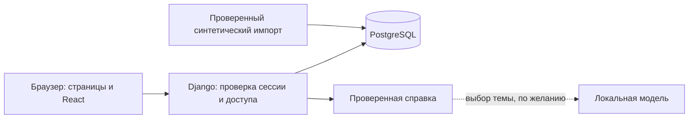

# Архитектура и данные

[Описание продукта](../README.md) · [Установка](SETUP.md)

## Один источник сохранённого состояния

Django 5.2.19 обслуживает страницы, сессии и операции. PostgreSQL 17.11 хранит учебные факты, действия пользователей, версии, уведомления и приватные файлы. React 19.3.1 и TypeScript 5.9.3 обеспечивают календарь, формы, материалы, уведомления и рабочие панели. Vite 7.3.7 собирает локальные JS/CSS/fonts; отдельного frontend-сервера при обычном запуске нет.

Роль приходит из серверной identity, связанной с учётной записью. Пользователь не выбирает её в форме. Учебный источник, авторский контент преподавателя и действия службы имеют разные правила изменения.

| Данные | Кто может менять |
| --- | --- |
| Профиль обучения, расписание, официальные результаты, сессия, требования | Только валидированный версионный импорт |
| Заявка и её исходные поля | Студент создаёт; владелец, содержание и факультет подачи затем неизменны |
| Статус, уточнение, решение заявки | Сервисы workflow после проверки студента или факультетской области сотрудника |
| Черновик и отправленная работа | Черновик принадлежит студенту; отправка создаёт неизменяемую версию |
| Назначение и авторские публикации | Назначение определяет полномочия; преподаватель публикует собственный материал или задание в его области |
| Отзыв и результат работы | Преподаватель, только к точной отправленной версии; официальный итог не меняется |
| Объявление и ресурс группы | Сотрудник своего факультета; публикация отделена от редактирования черновика |
| Личная подготовка и заметки | Только студент-владелец; каждая сохранённая редакция остаётся в истории |
| Отправленный план подготовки | Неизменный снимок в заявке; служба своего факультета отвечает через прежние статусы и уточнения |
| Время консультации и запись | Преподаватель или сотрудник задаёт время в своей аудитории; студент бронирует, отменяет или явно переносит свою запись |
| Фото, настройки, добровольные контакты | Владелец; email требует подтверждения, публикация группе — отдельного согласия |

## Поиск без второй копии данных

`discovery` собирает небольшие представления из существующих selectors. Текущие владелец, роль, учебное назначение, факультет, публикация и актуальность источника проверяются до текста результата, ранжирования, количества и страниц. Преподаватель не получает административные заявки и частные студенческие черновики; служба не получает список оценок. Прямые ссылки проходят обычную повторную проверку доступа.

Отдельно возвращается утверждённый каталог действий: открыть форму справки, подготовку, консультации, результаты или задания. Поиск не выполняет действие. После проверки области доступа PostgreSQL отбирает совпадающие метаданные по словам, явным синонимам и префиксам от трёх символов; только затем применяются ограничение и стабильное ранжирование. NFKC, русский регистр и «ё/е» согласованы с каталогом. Предельная длина — 100 символов, до восьми ключевых слов, по 200 совпадений из источника и по 10 результатов на странице. Записи на консультации и доступные интервалы имеют независимые пределы. Точный номер заявки проверяется отдельным разрешённым lookup. Каталог, справка и кнопка «Все оценки» используют общий маршрут `studies.routes.ALL_ASSESSED_RESULTS_URL`: все периоды, только внесённые результаты.

Нет векторного хранилища, отдельного изменяемого индекса или запроса к модели. SQL выбирает заголовки, номера и короткие метаданные, включая нужные ключи опубликованного JSON; целые тела публикаций, файлы, переписка, контакты и заметки не извлекаются для поиска. Уточнение запроса меняет SQL-отбор. При превышении предела счёт относится только к ограниченному результату; неполнота учебного источника обозначается отдельно. Каждый SQL-запрос ограничен двумя секундами внутри read snapshot; превышение даёт ответ о незавершённом поиске, без частичного успеха. Это рабочий предел прототипа, не доказательство масштабируемости. Текст поиска передаётся POST, не включается в URL и browser storage. Клиент отменяет старый запрос и проверяет его номер и поколение общего контекста сеанса.

## Подготовка и отправленный снимок

`Journey` принадлежит студенту и закрепляет конкретную редакцию одного из двух шаблонов: учебный обмен или проверка неточности. Личные шаги можно отмечать и снимать независимо. Состояния заявки и встречи выводятся из связанных доменов: чекбокс не может завершить рассмотрение или подтвердить посещение. Версия защищает от перезаписи из другой вкладки, а ключ операции — от повторного создания после потери ответа. `JourneyRevision` хранит неизменную историю; новая редакция шаблона не подменяет уже выбранную.

В обмене CV/мотивация, выписка, Learning Agreement и подтверждение языка — возможные категории, а не действующее требование. Для каждой студент записывает «Нужно уточнить», «Требуется» или «Не требуется» и основание. У примера есть явно вымышленная программа. Личная отметка сообщает только о действиях студента.

Перед отправкой сервер собирает точный снимок сохранённой подготовки. Подписанный предпросмотр связан с пользователем, контекстом сеанса, ситуацией, редакцией и содержимым; отправка заново проверяет всё это под блокировкой. Заявка «Проверка плана подготовки к обмену» создаётся через `student_requests.services` с `payload_schema=3`. Её исходное содержание неизменно, личная заметка включается только при явном выборе. Ранее принятые схемы и отпечатки заявок сохраняются. Последующие частные правки не меняют снимок: интерфейс показывает отправленную редакцию и наличие более новой подготовки.

Служба своего факультета видит снимок и явные ответы на уточнения. Она рассматривает план, не выдаёт допуск к обмену и не проверяет файлы, которые не загружались. Второй шаблон отправляет прежнюю заявку исправления учебных данных; ответ сотрудника не редактирует импортированный результат.

## Консультация как отдельное событие приложения

`ConsultationSlot` задаёт одного принимающего, аудиторию, начало и конец, тему и место либо явно указанную ссылку. Преподаватель использует действующее назначение на дисциплину и группу, сотрудник — свой факультет. `Booking` принадлежит студенту и хранит точный интервал подтверждённой встречи. Это событие приложения: оно показывается рядом с учебным расписанием, но не превращается в импортированный `Lesson` и не увеличивает число занятий.

PostgreSQL обеспечивает одну активную запись на интервал и запрет пересечений открытого времени одного принимающего и активных записей одного студента. Интервалы полуоткрытые: окончание одной встречи может совпадать с началом другой. Сервис соблюдает общий порядок блокировок: guard, сессия, принимающие и студент, интервалы, запись; после ожидания доступ проверяется заново. Проверка пересечения в интерфейсе дополняет эти ограничения, а не заменяет их.

Бронирование, отмена, перенос, история и необходимые уведомления сохраняются одной транзакцией. При переносе недоступность нового времени откатывает всё действие и оставляет прежнюю запись. Повтор того же намерения возвращает записанный результат после проверки текущих полномочий, даже если часы уже прошли время первоначальной операции. Новая отмена или перенос имеет новый ключ. Время, принимающий и аудитория не меняются незаметно после бронирования; исправление места имеет версию и уведомление.

Переход из подготовки передаёт `journey`; сервер проверяет владельца при чтении, подтверждении и повторе сохранённой операции. `journeys.booking_links` добавляет личную `JourneyBooking` внутри той же транзакции бронирования, без изменения редакции плана. Возврат строится сервером как `/journeys/{id}/`; произвольного redirect нет. Самостоятельная запись без подготовки и ручное связывание существующей записи сохраняются. Эта связь не передаёт план, личную заметку или заявку ведущему: передача доступной службе заявки выбирается отдельно.

Общая read-проекция консультаций проходит неизменяемую цепочку `Booking.replaces` только для студента-владельца. Старые связи A разрешаются в текущую C после A→B→C; несколько явных связей одной подготовки не дублируют карточку. Несколько подготовок могут явно ссылаться на ту же цепочку. A/B и реальные события переносов остаются доступны; отменённая C остаётся отменённой. Состояние встречи не копируется в `Journey.state`, миграция не нужна.

Совпадение с другой записью отклоняется. Известное учебное пересечение требует явного подтверждения студентом; неполное расписание не объявляется свободным временем. Более позднее изменение учебного источника может показать конфликт с сохранённой встречей, но не отменяет её автоматически. Служба не получает детали занятий для этой проверки. Связать заявку с консультацией можно только в допустимой области принимающего; её ID не открывает преподавателю административное дело.

Прошедшее время и чтение уведомления не доказывают посещение. Проведение отдельно отмечает принимающая сторона. Отменённая и завершённая встреча сохраняют историю; другие студенты видят доступность, без имени участника и его вопроса.

## Транзакции и история

Сохранение заявки, события и уведомления выполняется атомарно. Повтор того же ключа возвращает сохранённый результат. Ожидаемая версия защищает от перезаписи более нового решения. Общий guard, сессия и объект проверяются в установленном порядке, а доступ повторно проверяется после ожидания блокировки.

Учебный импорт проверяет схему, ссылки, полноту, исходное состояние и ожидаемую ревизию. Он согласованно меняет текущие факты, историю и уведомления. Пароли, сессии, заявки, решения, отзывы и прочтения не перезаписываются учебным источником. Время источника, время отображения и полнота данных различаются; ошибка источника не означает отсутствия занятий.

В уведомлениях есть входящие и история. Прочтение и очистка относятся к получателю, а не удаляют предметную историю. «Прочитать все» использует неизменный снимок; GET не записывает прочтения. Задача доставки email сохраняется с событием, выполняется отдельно и повторно проверяет доступ, адрес и предпочтения. По умолчанию используется локальное сохранение письма.

## Вход и приватность

Пароли хешируются штатным механизмом Django. Сессии хранятся в БД; доступ к каждому объекту проверяется на сервере, включая прямые URL файлов. Django Axes ограничивает неудачные входы по паре логин/IP. В local/direct режиме forwarded-заголовки не определяют IP клиента; особая доверенная цепочка для production описана [в инструкции эксплуатации](../deploy/README.md).

Браузер не сохраняет личные формы в localStorage. Тихая проверка действующей сессии сохраняет видимый документ и позицию. При настоящем выходе или смене аккаунта очищаются старые формы, файлы, поисковые результаты, заметки и ожидающие ответы. Если доступ не подтверждён, приватное содержимое недоступно для фокуса и вспомогательных технологий. Ответ после длительной операции проверяется повторно и на сервере, и в браузере. Новые компоненты используют прежний lifecycle, без отдельного опроса авторизации.

## Приватные файлы

Вложения хранятся бинарно в PostgreSQL и привязаны к точной неизменяемой версии. Допустимы PDF, DOCX, TXT UTF-8, JPEG, PNG и статичный WebP. Верхние пределы прототипа — 5 файлов, 10 МиБ на файл и 25 МиБ на отправку; преподаватель может установить более строгие условия. Инспектор ограничен по времени и памяти, но не является антивирусом.

Фото профиля — отдельный процесс: проверка, безопасное перекодирование в JPEG, хранение в БД и проверка аудитории при каждом запросе. Публичного каталога пользовательских файлов нет. Обычный pg_dump включает эти данные; исходный репозиторий содержит только синтетические входные примеры и выбранные скриншоты.

## Граница модели

Необязательная локальная модель получает текст вопроса и список разрешённых тем справки. Она выбирает идентификатор темы. Ответы, ссылки и ограничения роли задаёт сервер. Модель не читает БД, оценки, заявки, заметки, файлы или пароли, не бронирует встречи и не определяет условия или допуск к обмену. Поиск, подготовка и сохранение консультаций от модели не зависят. [Подключение и статусы](AI_ASSISTANT.md).

## Навигация по исходникам

| Каталог | Ответственность |
| --- | --- |
| `accounts`, `deanery` | Сессии, права, настройки, маршруты, готовность и помощник |
| `data_import`, `studies` | Проверяемый импорт и учебные представления |
| `student_requests` | Заявки и переходы состояний |
| `materials`, `workspaces` | Версии работ, публикации преподавателя, задания, уточнения и объявления |
| `discovery` | Поиск по разрешённым метаданным и каталог действий |
| `journeys` | Версионные шаблоны подготовки, личные редакции и связи с заявками и встречами |
| `consultations` | Время приёма, бронирование, переносы, история и представление событий |
| `profiles`, `notifications` | Настройки, фото, группа, аудитории, уведомления и почтовая очередь |
| `frontend`, `templates`, `static` | Компоненты, серверные страницы и локальные ресурсы |
| `fixtures`, `tests`, `scripts` | Синтетические наборы, воспроизводимые проверки и обслуживание |
