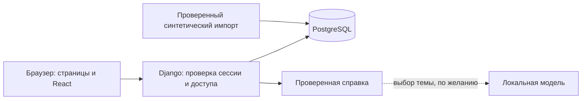

# Архитектура и данные

[Описание продукта](../README.md) · [Установка](SETUP.md)

## Один источник сохранённого состояния

Django 5.2.19 обслуживает страницы, сессии и операции. PostgreSQL 17.11 хранит учебные факты, действия пользователей, версии, уведомления и приватные файлы. React 19.3.1 и TypeScript 5.9.3 обеспечивают календарь, формы, материалы, уведомления и рабочие панели. Vite 7.3.7 собирает локальные JS/CSS/fonts; отдельного frontend-сервера при обычном запуске нет.

Роль приходит из серверной identity, связанной с учётной записью. Пользователь не выбирает её в форме. Учебный источник, авторский контент преподавателя и действия службы имеют разные правила изменения.

| Данные | Кто может менять |
| --- | --- |
| Профиль обучения, расписание, официальные результаты, сессия, требования | Только валидированный версионный импорт |
| Заявка и её исходные поля | Студент создаёт; владелец, содержание и факультет подачи затем неизменны |
| Статус, уточнение, решение заявки | Сервисы workflow после проверки студента или факультетской области сотрудника |
| Черновик и отправленная работа | Черновик принадлежит студенту; отправка создаёт неизменяемую версию |
| Назначение и авторские публикации | Назначение определяет полномочия; преподаватель публикует собственный материал или задание в его области |
| Отзыв и результат работы | Преподаватель, только к точной отправленной версии; официальный итог не меняется |
| Объявление и ресурс группы | Сотрудник своего факультета; публикация отделена от редактирования черновика |
| Фото, настройки, добровольные контакты | Владелец; email требует подтверждения, публикация группе — отдельного согласия |

## Транзакции и история

Сохранение заявки, события и уведомления выполняется атомарно. Повтор того же ключа возвращает сохранённый результат. Ожидаемая версия защищает от перезаписи более нового решения. Общий guard, сессия и объект проверяются в установленном порядке, а доступ повторно проверяется после ожидания блокировки.

Учебный импорт проверяет схему, ссылки, полноту, исходное состояние и ожидаемую ревизию. Он согласованно меняет текущие факты, историю и уведомления. Пароли, сессии, заявки, решения, отзывы и прочтения не перезаписываются учебным источником. Время источника, время отображения и полнота данных различаются; ошибка источника не означает отсутствия занятий.

В уведомлениях есть входящие и история. Прочтение и очистка относятся к получателю, а не удаляют предметную историю. «Прочитать все» использует неизменный снимок; GET не записывает прочтения. Задача доставки email сохраняется с событием, выполняется отдельно и повторно проверяет доступ, адрес и предпочтения. По умолчанию используется локальное сохранение письма.

## Вход и приватность

Пароли хешируются штатным механизмом Django. Сессии хранятся в БД; доступ к каждому объекту проверяется на сервере, включая прямые URL файлов. Django Axes ограничивает неудачные входы по паре логин/IP. В local/direct режиме forwarded-заголовки не определяют IP клиента; особая доверенная цепочка для production описана [в инструкции эксплуатации](../deploy/README.md).

Браузер не сохраняет личные формы в localStorage. Тихая проверка действующей сессии сохраняет видимый документ и позицию. При настоящем выходе или смене аккаунта очищаются старые формы, файлы и ожидающие ответы. Если доступ не подтверждён, приватное содержимое недоступно для фокуса и вспомогательных технологий. Ответ после длительной операции проверяется повторно и на сервере, и в браузере.

## Приватные файлы

Вложения хранятся бинарно в PostgreSQL и привязаны к точной неизменяемой версии. Допустимы PDF, DOCX, TXT UTF-8, JPEG, PNG и статичный WebP. Верхние пределы прототипа — 5 файлов, 10 МиБ на файл и 25 МиБ на отправку; преподаватель может установить более строгие условия. Инспектор ограничен по времени и памяти, но не является антивирусом.

Фото профиля — отдельный процесс: проверка, безопасное перекодирование в JPEG, хранение в БД и проверка аудитории при каждом запросе. Публичного каталога пользовательских файлов нет. Обычный pg_dump включает эти данные; исходный репозиторий содержит только синтетические входные примеры и выбранные скриншоты.

## Граница модели

Необязательная локальная модель получает текст вопроса и список разрешённых тем справки. Она выбирает идентификатор темы. Ответы, ссылки и ограничения роли задаёт сервер. Модель не читает БД, оценки, заявки, файлы или пароли и не выполняет действия. Поэтому её отсутствие не влияет на основную готовность приложения. [Подключение и статусы](AI_ASSISTANT.md).

## Навигация по исходникам

| Каталог | Ответственность |
| --- | --- |
| `accounts`, `deanery` | Сессии, права, настройки, маршруты, готовность и помощник |
| `data_import`, `studies` | Проверяемый импорт и учебные представления |
| `student_requests` | Заявки и переходы состояний |
| `materials`, `workspaces` | Версии работ, публикации преподавателя, задания, уточнения и объявления |
| `profiles`, `notifications` | Настройки, фото, группа, аудитории, уведомления и почтовая очередь |
| `frontend`, `templates`, `static` | Компоненты, серверные страницы и локальные ресурсы |
| `fixtures`, `tests`, `scripts` | Синтетические наборы, воспроизводимые проверки и обслуживание |
