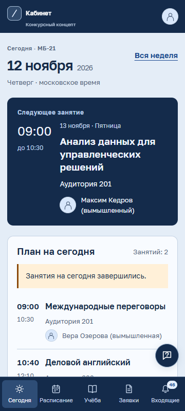

# Демонстрация связанных действий

[Установка](SETUP.md) · [Описание продукта](../README.md) · [Границы доступа](ARCHITECTURE.md)

После `prepare_demo` откройте http://127.0.0.1:8000/. Для одновременного показа используйте разные профили браузера: соседние вкладки одного профиля используют одну сессию.

| Логин | Роль и данные |
| --- | --- |
| `student_a` | Алина Миронова, МБ-21, международный бизнес; подробные результаты и примеры работ |
| `student_b` | Тимур Светлов, ЭК-11, другой факультет, другое расписание и результаты |
| `teacher_demo` | Преподаватель с назначением на свою дисциплину и группу |
| `staff_demo` | Елена Рябинина, служба факультета международного бизнеса |

Все сведения вымышлены. Пароли создаются один раз для установки и сохраняются при повторном заполнении и перезапуске. Откройте их локально командой `notepad .\.local\demo-credentials.json`.

## Подготовить короткий показ

Заранее войдите в отдельные окна `student_a` и `staff_demo`. Установите студенческому окну ширину 360 px. В кабинете службы проверьте наличие будущего свободного времени консультации. Если время примеров прошло или занято, создайте один разовый интервал с темой «Вопросы к плану подготовки», местом «Демо: кабинет 204» и аудиторией своего факультета. Выберите будущую дату по Москве; часы сервера остаются настоящими.

Если у студента уже есть незавершённая заявка этой подготовки, продолжайте её по сохранённому номеру. Новая отправка доступна после окончания предыдущего рассмотрения. На отдельной демонстрационной установке можно пройти весь путь с первой отправки.

## Сценарий до пяти минут

Ниже — план показа, а не утверждение о готовой видеозаписи. Время — ориентир для рассказчика; подготовка окон и вход выполняются заранее.

| Время | Действие и видимый результат |
| --- | --- |
| 0:00–0:30 | **Студент, мобильное окно.** Откройте «Поиск» в шапке и введите `обмен`. Перейдите в «Подготовиться к учебному обмену», нажмите «Начать подготовку» или «Продолжить подготовку». Покажите название вымышленной программы «Горизонт». |
| 0:30–1:25 | Проверьте отметку «Уточнить условия программы». Для Learning Agreement выберите «Нужно уточнить» и запишите основание «Демонстрационные условия: состав дисциплин нужно обсудить». Добавьте вопрос «Какие учебные вопросы включить в план?» и отдельную личную заметку. Сохраните подготовку. Откройте предпросмотр, оставив передачу заметки выключенной, покажите состав снимка и отправьте его. На экране появляется номер сохранённой заявки. |
| 1:25–2:25 | **Служба и студент.** В очереди `staff_demo` найдите заявку по этому номеру. Покажите снимок редакции: личной заметки в нём нет. Возьмите заявку в работу и запросите уточнение «Какие дисциплины вы хотите обсудить?». В студенческом окне откройте эту заявку, обновите состояние при необходимости и отправьте ответ. Служба рассматривает уточнение и завершает обработку с пояснением «План рассмотрен; следующий шаг — обсудить учебные вопросы на консультации». |
| 2:25–3:35 | **Студент.** Вернитесь к подготовке: ответ связан с отправленной редакцией. Откройте консультации, выберите свободное время службы, проверьте дату, принимающего, место и сообщение о пересечениях. При желании явно передайте связь с заявкой и короткий вопрос. Подтвердите запись; покажите «Запись подтверждена» и действие отмены. Если время уже занято, выберите другое: отсутствие подтверждения не выдаётся за успех. |
| 3:35–4:40 | Откройте «Сегодня», затем расписание на дату встречи. Консультация показана отдельно от занятий. Вернитесь в «Мои записи» и покажите время, место и историю. В окне службы доступна эта запись и только разрешённый контекст. Поясните: план рассмотрен, встреча забронирована; посещение и место на обмене этим не подтверждаются. |

При неполном расписании прочитайте соответствующее сообщение: прототип не обещает, что студент свободен. Известное учебное пересечение требует отдельного осознанного выбора; для обычного показа удобнее другое время.

## Дополнительные короткие маршруты

**Поиск справки и дисциплины.** Введите `справка` и откройте настоящую форму. После отправки найдите сохранённую заявку по номеру. Поиск по названию дисциплины ведёт к разрешённым учебным сведениям. Открытие результата само по себе не создаёт заявку или запись.

**Неточность в сведениях.** В «Заявки · Решить вопрос» выберите проверку неточности. Укажите предложенную учебную запись, опишите предполагаемую ошибку, сохраните подготовку и просмотрите обращение перед отправкой. Дальше используются прежние уточнения и решение заявки. Ответ сотрудника не изменяет импортированную оценку или расписание.

**Консультация преподавателя.** Войдите как `teacher_demo`, откройте дисциплину и консультации. Создайте время для своей учебной группы. Студент видит его при действующем назначении и зачислении на дисциплину. Прикреплённый ID факультетской заявки не открывает её преподавателю.

**Перенос.** У будущей записи выберите перенос, затем другое доступное время и подтвердите действие. Новая запись и связь с прежней сохраняются вместе. Если новое время недоступно, прежняя запись остаётся; отменять её заранее не требуется. Отмена сохраняет историю. Проведение встречи принимающий отмечает отдельно после её окончания.

**Редакции и личные заметки.** После отправки измените личную подготовку и сохраните. У заявки остаётся прежний снимок, а в подготовке появляется сообщение о более новых изменениях. Повторный вход возвращает сохранённую редакцию. Личная заметка не попадает в поиск и не открывается службе без явной передачи в следующем снимке.

## Студент: день, учёба, обращение

1. Войдите как `student_a`. На «Сегодня» найдите ближайшие занятия и важные события. В профиле видны факультет, программа, курс и группа.
2. Откройте расписание, выберите неделю с **23 ноября 2026 года**. Найдите изменённое занятие, аудиторию и преподавателя. Дата демонстрации не подменяет реальные часы сервера.
3. В «Учёбе» откройте результаты и «Все оценки». У Алины 22 внесённых итога за три периода; открытые требования показаны отдельно.
4. В заявках создайте справку: выберите назначение, вымышленного получателя и количество от 1 до 10. После отправки запишите номер из интерфейса.
5. Откройте уведомление или заявку, нажмите «Обновить статус». Ответ службы, история и исходные поля доступны рядом.

## Преподаватель: публикация и точный отзыв

Войдите как `teacher_demo`. В «Моих дисциплинах» видны назначение, группа и период. Откройте **«[Демо] Материал с двумя файлами»**. Отдельный **«[Демо] Частный план следующего занятия»** остаётся черновиком автора.

Студент в «Учёба → Материалы → Материалы преподавателя» открывает опубликованный текст и скачивает два файла. В заданиях есть **«[Демо] Аргумент и два примера»** и **«[Демо] Исправление учебного ответа»**. Второй пример содержит исходный ответ, отзыв и исправленную версию.

В очереди преподавателя выберите первый ответ, раскройте «Записать отзыв к версии 1», сохраните отзыв и результат. После обновления студент увидит их у отправленной версии. Результат относится к работе и не меняет официальный итог дисциплины. Частный черновик студента преподавателю недоступен.

Для нового цикла преподаватель создаёт задание, проверяет предпросмотр и публикует его. Студент открывает задание, нажимает «Начать ответ», вводит текст, при разрешённой политике добавляет файлы и отправляет преподавателю.

## Служба: уточнение и решение

Войдите как `staff_demo`, откройте заявки и найдите номер из первого сценария. Возьмите заявку в работу, задайте вопрос в блоке уточнения. Студент отвечает в своей заявке. Сотрудник обновляет статус, рассматривает уточнение и отдельно завершает обработку с пояснением. «Готова» означает завершение демонстрационной обработки, а не выпуск действительной справки.

Подготовленный пример с комментарием **«Синтетический пример учебного кабинета: уточнение назначения документа, создано явной командой»** уже содержит вопрос и ответ. Номер зависит от установки.

В объявлениях найдите **«[Демо] Консультация факультетской службы»**, а в группах — МБ-21 и ресурсы. Черновик объявления не виден студентам до публикации. Каталог службы содержит минимальные учебные сведения, без личных оценок и работ студентов.

## Разделение и сохранение

Войдите вторым студентом. Его профиль, учебные факты и аудитория отличаются; чужая заявка, подготовка или приватный файл по прямой ссылке не раскрываются. Поиск чужого номера заявки не показывает её название или существование. Чужие записи на консультацию не раскрывают участника и вопрос. После нового входа первого студента сохранённая подготовка, решение и запись остаются доступными.

Помощник справа открывает готовые вопросы и ссылки без ИИ. Если провайдер отключён или недоступен, статус показан внутри панели. Поиск, подготовка, бронирование и прежние учебные действия выполняются обычными сервисами независимо от модели.

При обычном перезапуске заполнение не нужно. Явный повтор `prepare_demo --database deanery_demo` сохраняет уже выполненные действия и даты встреч. Внешняя почта, официальный приём на обмен и связь с настоящей службой вуза в этом сценарии не выполняются.
