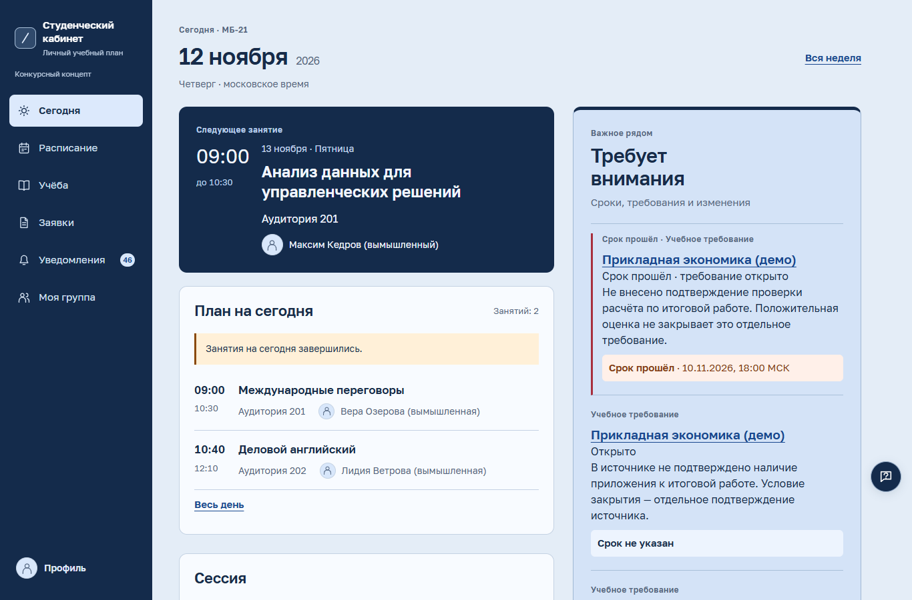
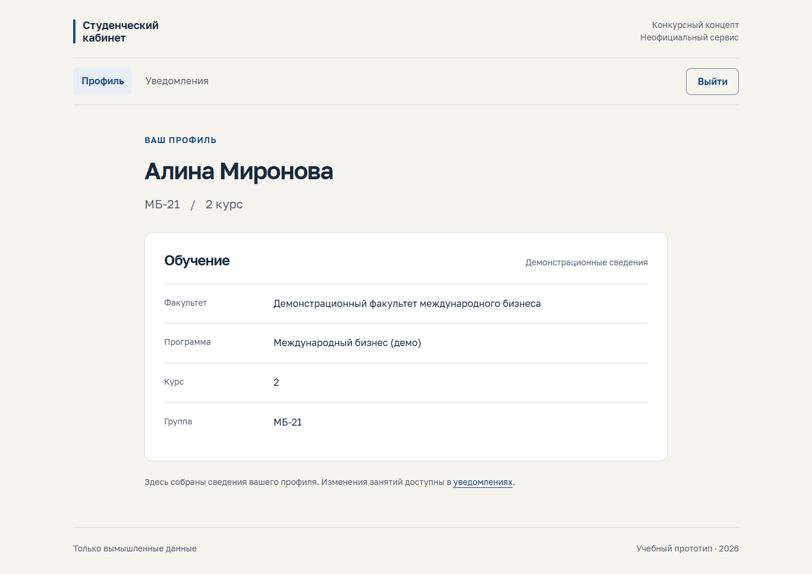
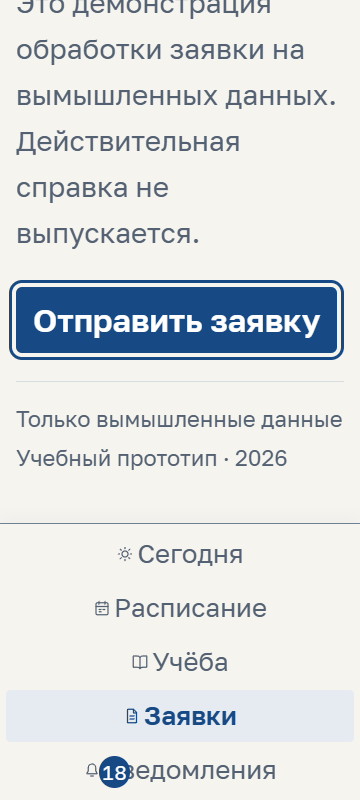
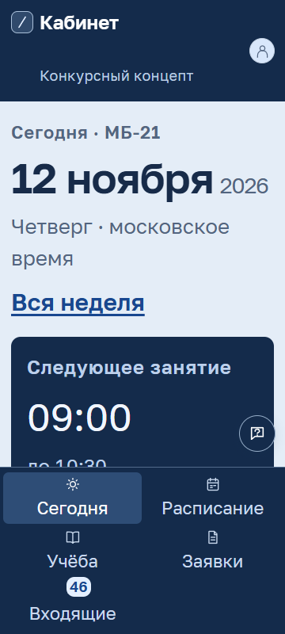
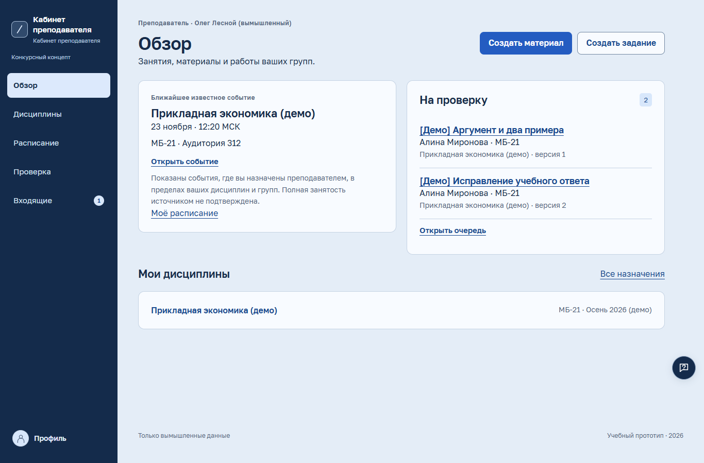
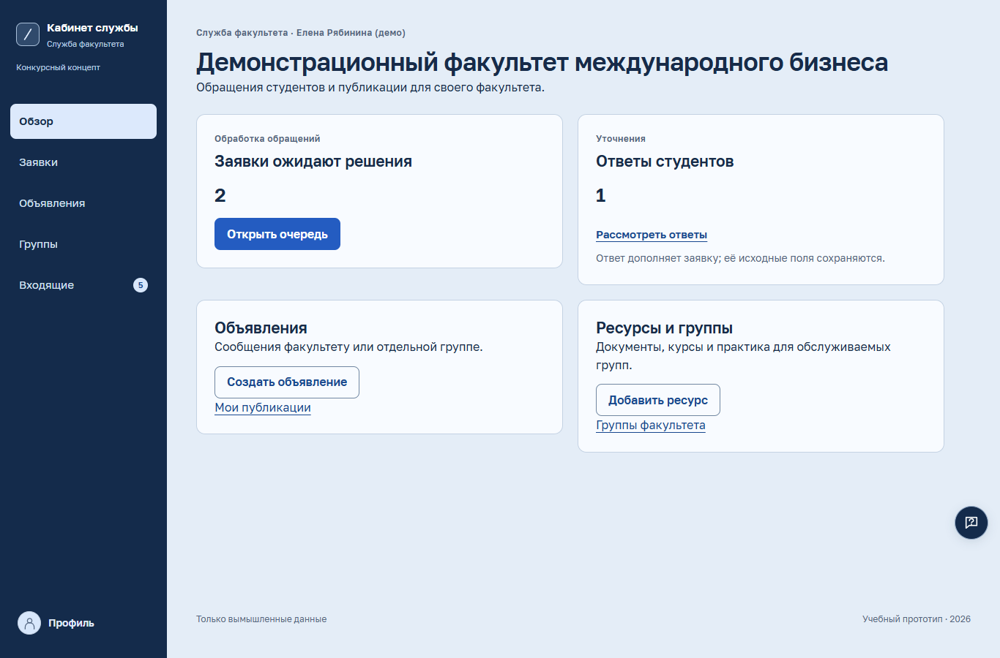
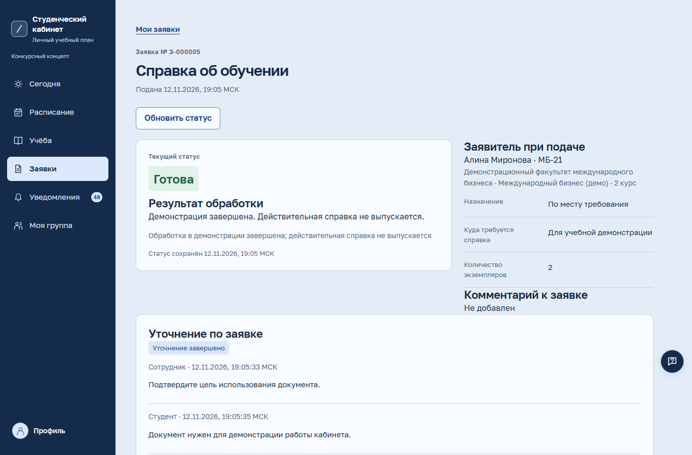
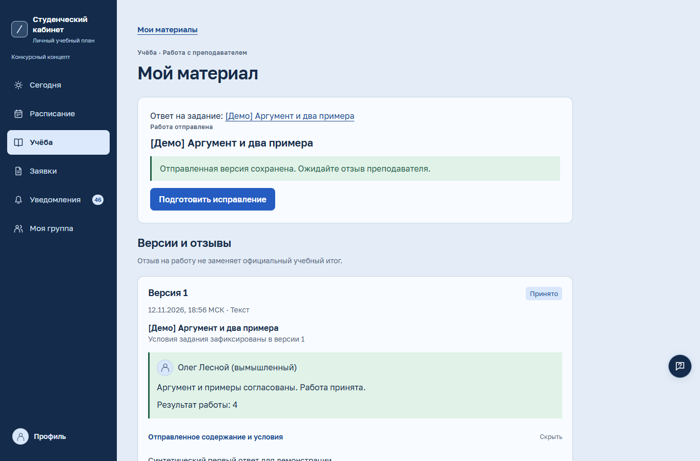
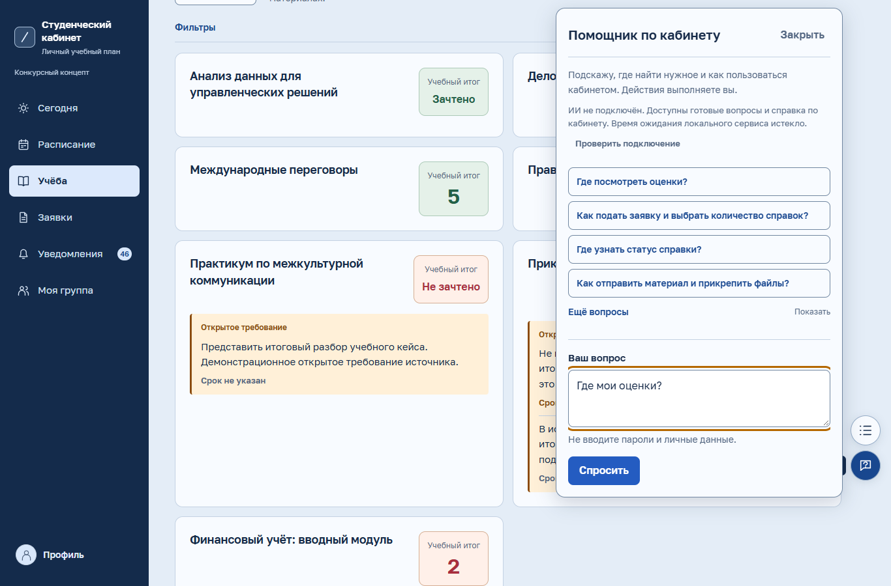

# Как создавался «Цифровой деканат»

[PDF для чтения](creation-process.pdf) · [Редактируемая версия HTML](creation-process.html) · [Продукт и запуск](../README.md)

Это история конкурсного прототипа, обновлённая 13 ноября 2026 года по сохранённым заданиям, исходникам, снимкам браузера и результатам проверок. Все показанные люди и учебные записи вымышлены. Выборка показывает развитие решения; полная локальная история сохранена отдельно. Интервью с пользователями не проводились; изучались открытые институциональные описания отдельных функций, без входа в университетские системы.

## От задачи студента к пяти разделам

Исходная задача — личный кабинет, в котором студент может понять свой учебный день, проверить результаты и обратиться в деканат. Рабочая гипотеза: расписание, учебные условия и статус обращения проще сопоставлять в одном месте. Это проектное обоснование, а не измеренный эффект внедрения.

Поэтому основой стали **«Сегодня», «Расписание», «Учёба», «Заявки», «Уведомления»**. Вход и профиль определяют владельца кабинета. «Сегодня» связывает ближайшее занятие с важными изменениями; недельный календарь помогает планировать; «Учёба» объединяет официальные итоги и отдельную работу с преподавателем. Заявка заканчивается сохранённым решением, уведомление возвращает к событию. Позже к этому пути добавлены общий поиск, сохранённая подготовка вопроса и консультации. На телефоне пять основных разделов остаются в нижней навигации.

*12 ноября, настоящий Chrome, окно 1366 × 900. Источник учебных фактов, текущее время и состояние заявки не подменяют друг друга. Просроченное требование показано с причиной; положительная оценка сама по себе его не закрывает.*

## Инструменты и распределение работы

| Инструмент | Фактическое применение |
| --- | --- |
| ChatGPT | Исследование задачи, подготовка английских заданий для Codex, разбор результатов и формулирование следующих исправлений. Исторические версии моделей полностью не установлены. |
| Codex | Исходники, команды, синтетические данные, документация, запуск проверок и исправления. Ограниченные агенты разрабатывали поиск, консультации и интерфейс, отдельно проверяли доступ и поведение. В одной ранней записи указан `gpt-6-astra`; это не основание приписывать ту же модель всем сессиям. |
| PowerShell, Git, rg, Python, venv, pip | Работа с файлами, поиск, история изменений, изолированные зависимости и воспроизводимые команды. Публичный снимок отделён от полного рабочего архива. |
| Django, PostgreSQL, psycopg, Django Axes | Сессии, права, хранение, проверяемый импорт, транзакции и ограничение попыток входа. |
| React, TypeScript, Vite | Реальные интерактивные компоненты календаря, материалов, уведомлений, форм и помощника; проверка типов и готовая сборка для Django. |
| Playwright, Chrome/CDP, Firefox, просмотр изображений, ffmpeg | Проверки настоящих страниц, клавиатуры, DOM и доступности элементов, снимки и записи отдельных сценариев. Размеры мобильного окна эмулировались. |
| Web и первичные документы | Проверка технических контрактов и исследование интерфейсных подходов. Refero, UIWiki и Impeccable использовались как справочные материалы; их изображения и код в продукт не переносились. |
| Docker Desktop/Linux, Gunicorn, Caddy | Ранние локальные проверки установки и HTTPS-схемы. Текущая полная установка проверена на Windows. |
| Ollama и Qwen | Локальная классификация вопроса в разрешённую тему справки. Это отдельная возможность готового продукта. |
| pypdf, PDFium, Pillow, браузерная печать | Проверка файлов, создание и просмотр документа. Генерация изображений для иллюстраций процесса не использовалась. |

В прошлой работе применялся и процесс Sites для локального просмотра checkout; размещения через Sites не было. Названия IDE, состав команды, часы работы и иные незафиксированные инструменты здесь не реконструируются. Версии нынешних зависимостей перечислены в [уведомлениях о компонентах](THIRD_PARTY_NOTICES.md).

## Итерации интерфейса и реальные исправления

Первый работающий кабинет уже связывал вход с собственными учебными данными. После этого внимание сместилось к плотности и ясности: убрать повторение, оставить факт, причину и действие. Пользователь задавал направление оформления и возвращал замечания по настоящим экранам.

*7 ноября. Подлинный промежуточный профиль. Светлое оформление относится к прошлой версии; позже пользователь выбрал тёмно-синие и голубые поверхности, компактность при обычном масштабе и отсутствие декоративных стрелок.*

Дословный фрагмент задания по упрощению интерфейса:

> Reduce repetition and competing emphasis, while keeping necessary information understandable and visible.

Русское пояснение: уменьшить повторение и конкурирующие акценты, сохранив необходимую информацию. Это пояснение автора документа, а не перевод, выдаваемый за исходный диалог.

Один из обнаруженных дефектов: при увеличении текста счётчик перекрывал подпись мобильной навигации. Проверка только обычного масштаба этого не показывала. Компоновку изменили с учётом переноса текста и независимо проверили строки списков.

| Ранняя ошибка, 7 ноября | После последующих доработок, 12 ноября |
| --- | --- |
|  |  |

*Оба снимка — настоящий браузер, ширина 360 px, увеличенный до 200% базовый текст. Справа — новая проверка текущей версии с базовым шрифтом 32 px. Показаны разные разделы, поэтому это сравнение поведения навигации, а не идентичных записей. Историческое изображение не реконструировалось.*

Дословный фрагмент следующего задания:

> Important status must not depend on color alone.

Русское пояснение: важный статус обозначается текстом, а цвет помогает его заметить. Эта логика применяется к отсутствующему итогу, просроченному требованию и решению по заявке.

Другой существенный дефект касался фоновой проверки сеанса: обычная проверка могла скрывать документ, закрывать панель и мешать чтению. Проверку действующего доступа отделили от настоящего скрытия и сброса при смене владельца. Панели стали немодальными и размещаются рядом с фиксированными кнопками.

Дословные фрагменты задания о панелях:

> Open each panel next to its button, normally above or to its left with viewport collision handling.

> On narrow screens, fit the panel inside the visible viewport and above the bottom navigation/software keyboard.

При подготовке публикации повторно проверены ввод и прокрутка при двух проверках сеанса, а также границы панели на 1366 и 360 px. Ошибка доступности сервиса ИИ не должна закрывать кабинет.

## От отдельных экранов к связанным ролям

Расписание и официальные результаты поступают через версионный импорт. Собственные действия студента живут отдельно: черновик, отправка, заявка, ответ на уточнение. Затем добавлены рабочие места преподавателя и факультетской службы с ограничением их назначений и аудитории.

*12 ноября. Преподаватель видит свои назначения и очередь точных отправленных версий. Поздний черновик студента в очередь не попадает.*

*12 ноября. Служба работает с заявками, уточнениями, объявлениями и группами собственного факультета.*

В новой демонстрационной установке проверен полный обмен: студент подал заявку на два экземпляра, сотрудник взял её в работу и запросил уточнение, студент ответил, сотрудник завершил обработку. Статус и история стали доступны владельцу. Другой студент не получил заявку по прямой ссылке.

*12 ноября. Результат демонстрационный: действительная справка не выпускается.*

Отдельно преподаватель сохранил отзыв к первой версии ответа на задание; студент увидел этот отзыв и результат работы. Это не изменение официальной оценки дисциплины.

## Найти, подготовиться, получить консультацию

Следующее задание связало уже работающие разделы вокруг конкретного вопроса студента. Его смысл: человек должен найти действие обычными словами, подготовить содержательный план, получить сохранённую запись на встречу и затем вернуться к ответу. Одних экранов с похожими карточками для этого было недостаточно: требовались общие права, история и согласованные операции.

Открытые материалы МГИМО помогли выделить подготовку документов как задачу; описания ИТМО — явные этапы обмена; MyUW — поиск по сервисам; Stanford — запись к соответствующему консультанту. В документе [исследования и решений](RESEARCH_DECISIONS.md) у каждого источника указаны использованный подход, доступная дата и ограничения. Документация подтверждает описанную функцию, а не её удобство для наших студентов. Чужие правила и давняя памятка не стали действующими условиями МГИМО.

| Шаг студента | Принятое решение |
| --- | --- |
| Найти действие | Общий поиск в шапке: проверенные действия и только доступные текущие объекты. Метаданные сопоставляются по словам и явным синонимам, без зависимости от модели. |
| Подготовить вопрос | Два ограниченных шаблона: вымышленный учебный обмен и проверка неточности. Личные шаги и заметки сохраняются по редакциям. |
| Передать план | Предпросмотр точно показывает передаваемый снимок. Личная заметка включается только по выбору; сотрудник не получает доступ к живому черновику. |
| Обсудить с человеком | Разовое время преподавателя или службы ограничено назначением и факультетом. Бронирование подтверждается сохранённой записью; перенос выполняется целиком или оставляет прежнюю встречу. |
| Продолжить после ответа | Уточнения и решения остаются в прежней заявке. Запись видна на «Сегодня» и в расписании как отдельная встреча, без изменения числа учебных занятий. |

Подготовка к обмену получила явно вымышленную программу «Горизонт». CV/мотивация, выписка, Learning Agreement и подтверждение языка представлены как возможные категории с выбором применимости и основанием. Отметка описывает действие студента; рассмотрение плана не означает проверку файлов, номинацию или зачисление. Поздние изменения подготовки не переписывают отправленный снимок и не присваивают ему старый ответ.

## Как распределили работу ИИ и исправляли результат

Владелец интеграции сохранял общий контроль над настройками, жизненным циклом сеанса, миграциями и рабочей БД. Один агент реализовывал поиск и отдельно читал границы владения подготовкой; другой — транзакции консультаций; третий — интерфейс консультаций, ограниченное исследование и браузерный разбор. Границы файлов сообщались заранее. Независимая проверка здесь означает дополнительное чтение другим ИИ, а не внешний человеческий аудит.

Рабочие инструкции сохраняли конкретную цель, допустимые изменения и признаки завершения. Агенты читали действующие сервисы и документы затронутой области, согласовывали небольшие контракты и проверяли рискованные места. Автономная работа ограничивалась согласованной областью; общие изменения и проверки собирал владелец интеграции.

Разбор обнаружил случаи, которые легко пропустить на обычном экране. После защитного скрытия ожидание операции могло оставлять форму занятой; клиент теперь сохраняет возможность проверить результат и повторить то же намерение. Неподходящий JSON-тип мог приводить к ошибке сервера; входные типы проверяются до поиска и сохранения. У будущей встречи потребовалось учитывать границы учебного назначения и источника. Проверка типов также нашла отсутствующее поле связанной заявки в описании ответа.

Браузерный просмотр поиска обнаружил отдельную проблему полезности: при большом количестве справок настоящая форма заказа уходила за первую страницу. Совпавшим проверенным действиям дали явный приоритет, сохранив отдельный точный поиск по номеру заявки. Регрессионная проверка воспроизводит этот случай с тридцатью однотипными объектами и проверяет стабильность порядка.

Перед изменением схемы сохранена защищённая копия; обновление применялось к отдельной БД с проверкой сохранности прежних записей. Проверки поиска и консультаций включали реальные соединения PostgreSQL, конкуренцию за последнее место, повторы и границы доступа. В первом запуске проверок подготовки два сбоя относились к самим тестовым сценариям: предположению о порядке ключей JSON и повторному входу без завершения прежнего сеанса. Эти сценарии исправлены; неудачный запуск сохранён отдельно. Точные завершённые проверки, повторения и ограничения сведены в [проверки продукта](VALIDATION.md), без обещания общего результата по одному удачному прогону.

## Вход, хранение и защита простыми словами

Пароль проверяет Django; в БД хранится его хеш. Сессия определяет пользователя, а сервер проверяет доступ к каждому личному объекту. Подмена номера заявки, работы или файла в адресе не меняет владельца. Преподаватель имеет отдельную identity и текущее назначение, сотрудник — область своего факультета.

Сохранённая отправка фиксирует содержание и условия приёма. Отзыв связан с этой версией. Черновик можно менять отдельно. Так же устроена проверка плана: служба отвечает на отправленный снимок, а не на будущие частные правки. Учебный импорт не сбрасывает заявки, прочтения, пароли, решения и встречи. Событие, история и уведомление согласуются одной транзакцией.

*12 ноября. Реально сохранённый отзыв к версии 1; поздние изменения не переписывают эту версию.*

Файлы и перекодированные фото хранятся в PostgreSQL, а не в общедоступном каталоге. При скачивании снова проверяется аудитория. Тип, размер и структура вложения ограничены; такой инспектор не называется антивирусом. Контакты одногруппника видны только при его отдельном согласии. Старые ответы и несохранённый ввод очищаются при смене сеанса или прав, но обычная проверка доступа не прерывает чтение.

Это реализованные меры прототипа, а не сертификация безопасности. Детали — в [архитектуре](ARCHITECTURE.md).

## Необязательный ИИ и честный запасной режим

В ранней проверке использовались установленный Ollama 0.33.2 и Qwen3-4B-Instruct-2507 Q4_K_M. Модель выбирала разрешённую тему, сервер возвращал текст справки и разрешённую ссылку. В первом наборе из 12 вопросов обнаружены три ошибки понимания. После уточнения правил повтор того же набора дал 12 корректных выборов. Это результат небольшого конкретного набора, не общая оценка качества модели.

При подготовке публикации обнаружено другое ограничение: заполненные настройки ещё не означали доступный сервис. Добавлены состояния отключения, проверки, недоступности сервиса, отсутствующей модели, готовности и ошибки inference. Наличие установленной модели проверяется по `/api/tags`, а не по списку моделей в памяти. Новая установка по умолчанию работает без ИИ.

Дословный фрагмент задания публикации:

> Availability and the provenance of a particular answer are separate: a predefined topic can return a FAQ answer while a model is available, and model presence alone is not a successful inference.

Русское пояснение: доступность модели и происхождение отдельного ответа различаются. Нажатие готового вопроса не выдаётся за обращение к модели. При отказе сервиса остаются готовые темы и локальный подбор справки.

*12 ноября. Сервис не запущен; интерфейс сообщает об истечении ожидания и оставляет справку доступной. Это не снимок успешного inference.*

В этой публикационной проверке положительный ответ провайдера моделировался только управляемым локальным HTTP-сервером. Реальную Qwen заново не запускали и не скачивали. Независимый разбор обнаружил ещё три пограничных случая: перезапись чужого локального файла паролей при новом заполнении, гонку готового вопроса с проверкой подключения и слишком глубоко вложенный JSON. Для них внесены адресные исправления. [Настройка и ограничения помощника](AI_ASSISTANT.md).

Для новых действий расширены утверждённые темы справки по ролям. Модель может направить к подготовке или консультациям, но не читает заметки, не бронирует встречу и не определяет допуск к обмену. Поиск, сохранение подготовки и запись используют обычные сервисы. Их работоспособность не основана на наличии модели; проверки самого классификатора с подставленными ответами не выдаются за реальный inference.

## Вклад человека и проверяемый результат

13 ноября связанный путь прошёл в настоящих независимых сеансах студента, службы и преподавателя, затем сохранился после перезапуска. Дополнительный разбор выявил три крайних случая: уведомления одной встречи не группировались, встреча через полночь отсутствовала во втором дне, некорректный Unicode вызывал ошибку сервера. Они исправлены и проверены адресно. На 320 px с увеличенным текстом отдельно исправлены профиль в шапке и перекрытый фокус; результат просмотрен в Chrome и Firefox. Ошибки проверочных скриптов сохранены отдельно и не приписаны приложению. [Результаты и пределы](VALIDATION.md).

Подтверждённый вклад пользователя — выбор кейса и предоставление требований, подготовка заданий совместно с ChatGPT, перенос результатов между средами, просмотр результатов Codex, свои снимки экрана, обратная связь о поведении и запросы исправлений. Пользователь определил оформление, компактность, положение инструментов справа, сохранение чтения и отказ от декоративных стрелок. Эти решения направляли следующие итерации.

Код, технические документы и наблюдаемые проверки выполнялись Codex через перечисленные инструменты. Пользователю не приписываются незафиксированные интервью, ручное программирование, часы работы или построчное утверждение исходников. Ограниченные независимые проверки были дополнительным разбором ИИ и не называются внешним человеческим аудитом.

Для исходной публикации 12 ноября подготовлена самостоятельная выборка исходников, frontend-сборка, миграции, синтетические данные, лицензии и команда `prepare_demo`. Тогда на пустой отдельной PostgreSQL были проверены установка, четыре входа, сценарии трёх ролей и работа без Ollama; повтор после действий сохранил все 74 таблицы и файл паролей. Новое расширение сохраняет эту основу, добавляет версионную подготовку и консультации через явную команду и проверяется по изменённым рискам. Полный локальный архив и прежний большой документ сохранены отдельно; актуальная область проверки указана в [описании проверок](VALIDATION.md).

Публичный сервер, доставка настоящих писем, доступ из российской сети, физические телефоны и конкурсная подача этой проверкой не подтверждаются. Закрытая видимость репозитория также требует отдельного предоставления доступа организаторам. Это границы результата, а не скрытые шаги установки.

Дальнейшее чтение: [запуск](SETUP.md), [демонстрация](DEMO.md), [проверенные сценарии](VALIDATION.md), [права и сторонние материалы](RIGHTS.md).
