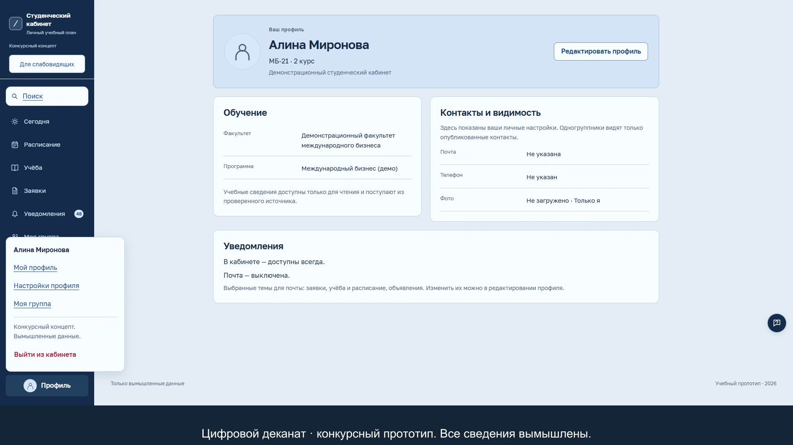

# Демонстрация «Цифрового деканата»

[Смотреть или скачать MP4](https://github.com/AiratBastanov/MGIMOSlop/releases/download/v2026.11.15-demo/digital-deanery.mp4) · [Выпуск и исходники](https://github.com/AiratBastanov/MGIMOSlop/releases/tag/v2026.11.15-demo)

[](https://github.com/AiratBastanov/MGIMOSlop/releases/download/v2026.11.15-demo/digital-deanery.mp4)

В настоящем браузере студент находит расписание и оценки, отправляет заявку, получает сохранённый ответ службы и отзыв преподавателя к версии работы. Короткое продолжение показывает подготовку, консультации, мобильное окно и обратимый режим чтения. Все сведения вымышлены; запись выполнена 15 ноября 2026 года на отдельной демонстрационной базе со сборкой `release.eee5351938dc`.

| Свойство | Значение |
| --- | --- |
| Продолжительность | 4:22 (262 секунды) |
| Изображение | 1920×1080, 16:9, 25 кадров/с |
| Формат | MP4, H.264, yuv420p, быстрое начало воспроизведения |
| Размер | 6 284 370 байт |
| Подписи | Русские, включены в изображение; отдельно [SRT](demo.ru.srt) и [текст](transcript.ru.md) |
| Звук | Звуковой дорожки нет |
| Мобильная сцена | Эмуляция браузерного окна 360×800 CSS px, без увеличения исходного изображения |

SHA-256 файла `digital-deanery.mp4`:

```text
2b84699c13c7df6c003e09a093993fc3c961f99f2878b412b6cce32ddd00593c
```

Ролик воспроизведён целиком от начала до конца; дополнительно проверены последовательность сцен, читаемость подписей и полное декодирование. Скорость взаимодействий не менялась. Монтаж соединяет отдельные окна ролей; это демонстрация поведения, а не измерение производительности или исследование удобства с людьми.

[Последовательность сцен](../DEMO.md#готовое-видео-422) · [Как повторить запись](RECORDING.md) · [Вернуться к продукту](../../README.md)
